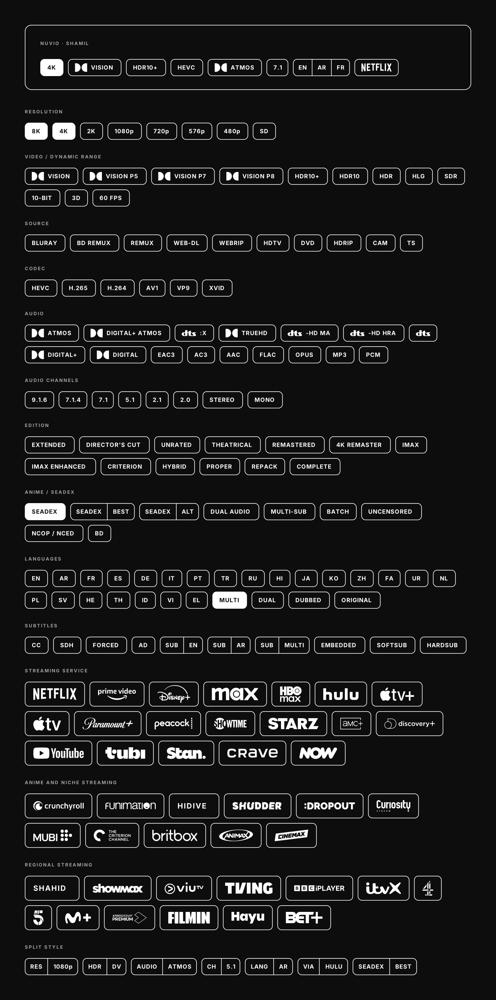

# Nuvio Shamil Badges

Minimal, all-in-one (**شامل / Shamil**) media badges for Nuvio: white outlines on any dark background, no gradients, no colors.



**169 badges** in two formats (SVG + 4x transparent PNG) and a machine-readable `manifest.json`.

## What's inside

```
nuvio-shamil-badges/
├── manifest.json     # every badge: id, category, label, size, match aliases, file paths
├── preview.png       # full overview sheet
├── png/              # transparent PNGs @4x (use these by default)
└── svg/              # vector versions
```

| Category | id | Badges |
|---|---|---|
| Resolution | `resolution` | 8 |
| Video / dynamic range | `video` | 12 |
| Source | `source` | 10 |
| Codec | `codec` | 6 |
| Audio | `audio` | 16 |
| Audio channels | `audio-channels` | 8 |
| Edition | `edition` | 13 |
| Anime / SeaDex | `anime` | 9 |
| Languages | `languages` | 27 |
| Subtitles | `subtitles` | 10 |
| Streaming service | `streaming-service` | 19 |
| Anime and niche streaming | `anime-and-niche-streaming` | 11 |
| Regional streaming | `regional-streaming` | 13 |
| Split style | `split-style` | 7 |

## Naming

Every file is `<category>_<name>`, for example `resolution_4k`, `audio_dolby-atmos`, `streaming-service_netflix`, `anime_seadex-best`. The `+` sign is written as `plus` (`streaming-service_disney-plus`, `video_hdr10-plus`). The same id is used in `manifest.json`, so `png/<id>.png` and `svg/<id>.svg` always exist for every entry.

## Using the manifest

Each entry looks like this:

```json
{
  "id": "audio_dolby-atmos",
  "category": "audio",
  "label": "Dolby ATMOS",
  "kind": "logo",
  "match": ["atmos", "dd+ atmos", "dolby atmos"],
  "width": 142, "height": 44,
  "svg": "svg/audio_dolby-atmos.svg",
  "png": "png/audio_dolby-atmos.png"
}
```

`match` holds lowercase aliases (for example `2160p`, `dovi`, `ddp`, `amzn`) to help you map release names or addon metadata to a badge:

```js
const BASE = 'https://raw.githubusercontent.com/<user>/<repo>/main/';
const manifest = await (await fetch(BASE + 'manifest.json')).json();

const find = (term) => manifest.badges.find(b => b.match.includes(term.toLowerCase()));
const badge = find('dovi');                 // Dolby Vision
const url = BASE + badge.png;
```

`kind` is `text` (plain label), `logo` (brand mark plus optional label) or `split` (label and value separated by a divider). Aliases are a starting point, so extend them for your own parser.

## Design spec

- White `#FFFFFF` 1.5 px outline, 10 px corner radius, transparent fill (filled-white for a few premium tiers like 4K/8K, MULTI, SEADEX).
- Height 44 (standard) and 64 (streaming services). Widths vary by content.
- Made for dark surfaces (the preview uses `#0D0D0D`). On light backgrounds, invert them.

## Notes

- **Use the PNGs if you want guaranteed rendering.** Text inside the SVGs uses the **Inter** font (SemiBold), so SVGs show a fallback font where Inter isn't installed.
- **HIDIVE** and **SHAHID** are text wordmarks because no logo was available. **SeaDex** is a text badge. Dolby Vision, Atmos, TrueHD and Digital are the Dolby mark plus a text label (not Dolby's official lockups), and the DTS badges likewise use the DTS mark plus a text label.

## Credits and trademarks

The badge frame design, layout and text badges are original to this pack. Brand marks (streaming services, Dolby, DTS, etc.) are trademarks of their respective owners and are included for identification only, with no affiliation or endorsement. Dolby and DTS marks come from [Simple Icons](https://simpleicons.org). The streaming and network wordmarks were vector-traced from the white logo sets in [Kometa Default-Images](https://github.com/Kometa-Team/Default-Images). Check the licenses and brand guidelines of those sources and owners before redistributing or using the pack commercially, and add a `LICENSE` file of your choice for the parts you own.
